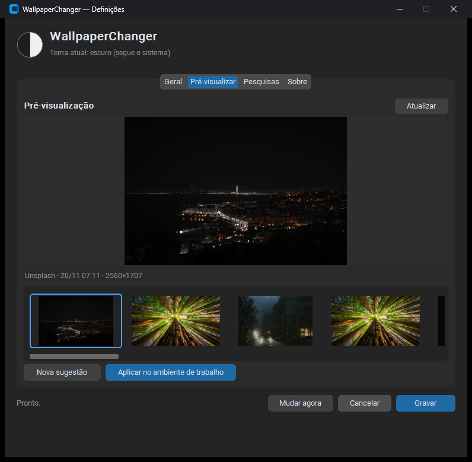
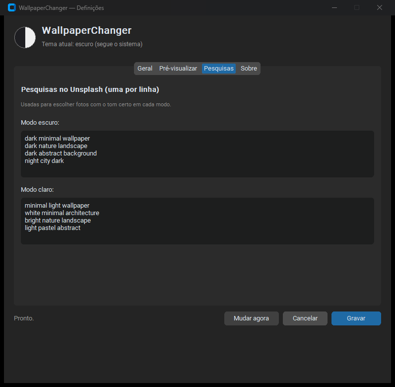
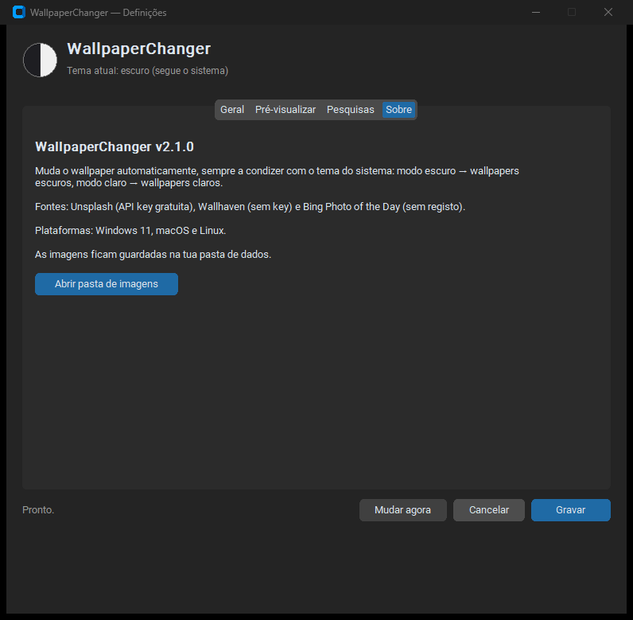

# WallpaperChanger

[](https://github.com/desorderrr/wallpaper-changer/actions/workflows/build.yml)
[](LICENSE)
[](https://www.python.org)

Muda o wallpaper automaticamente, **sempre a condizer com o tema do sistema**: modo escuro → wallpapers escuros, modo claro → wallpapers claros. Disponível para **Windows 11, macOS e Linux**, com ícone na bandeja do sistema e uma janela de definições moderna.


## Funcionalidades

- **Tons escuros/claros garantidos** — a app mede a luminância real de cada imagem antes de a aplicar; nunca põe um wallpaper claro em modo escuro (nem o contrário)
- **Segue o tema do sistema** — no Windows lê o "modo das aplicações" (`AppsUseLightTheme`) e o "modo do Windows"; deteta também macOS e Linux (GNOME, KDE, XFCE, Cinnamon, MATE). Ao mudar o tema, o wallpaper troca em segundos
- **Pré-visualização tipo Wally** — separador com o wallpaper atual em grande, galeria das imagens recentes (clica para pré-visualizar), botão **Nova sugestão** (procura uma imagem nova sem aplicar) e **Aplicar no ambiente de trabalho**
- **Três fontes de imagens**
  - [Unsplash](https://unsplash.com/developers) — API oficial, necessita de uma *Access Key* gratuita
  - [Wallhaven](https://wallhaven.cc) — milhões de wallpapers em 2K+, **sem key**
  - [Bing Photo of the Day](https://www.bing.com) — sem registo, com variedade dos últimos 8 dias
  - **Escolhe só uma fonte ou combina várias** (checkboxes independentes)
- **Intervalos**: apenas ao iniciar, 5, 10, 15, 30 minutos, 1, 2, 3, 6, 12 horas ou diário
- **Pausar mudanças automáticas** — pausa sem fechar a app; o "Mudar agora" continua a funcionar
- **Arranque automático** com o sistema (Registo no Windows, LaunchAgent no macOS, autostart XDG no Linux)
- **Interface moderna** (customtkinter) em modo escuro/claro automático
- **Instância única**, atualização dos wallpapers com proteção contra trocas simultâneas e limpeza automática das imagens antigas
- Guarda as últimas N imagens na pasta de dados, com pesquisas configuráveis por tom

| Pré-visualização | Pesquisas | Sobre |
|---|---|---|
|  |  |  |

## Instalação

### Windows 11

1. Descarrega `WallpaperChanger.exe` da página de [Releases](https://github.com/desorderrr/wallpaper-changer/releases) (ou dos artefactos do CI)
2. Corre o `.exe` — aparece o ícone **meio-escuro/meio-claro** na bandeja (seta `^` junto ao relógio)
3. Botão direito no ícone → **Definições...**

### macOS

Requer Python 3.10+:

```bash
git clone https://github.com/desorderrr/wallpaper-changer.git
cd wallpaper-changer
pip install -e .
python -m wallpaper_changer
```

Na primeira troca de wallpaper o macOS pede autorização para controlar o **System Events** — aceita para a app poder mudar o fundo.

Também podes gerar a app: `bash scripts/build_macos.sh` (cria `dist/WallpaperChanger.app`).

### Linux

Requer Python 3.10+ e `tkinter`:

```bash
sudo apt install python3-tk python3-venv     # Debian/Ubuntu
git clone https://github.com/desorderrr/wallpaper-changer.git
cd wallpaper-changer
python3 -m venv .venv && . .venv/bin/activate
pip install -e .
python -m wallpaper_changer
```

Bandeja do sistema:

- **GNOME**: instala a extensão [AppIndicator](https://extensions.gnome.org/extension/615/appindicator-support/) e `gir1.2-ayatanaappindicator3-0.1`
- **KDE / XFCE / Cinnamon / MATE**: funciona com o backend X11 (`python-xlib` é instalado automaticamente)
- Em Wayland puro sem XWayland, a bandeja pode não aparecer — o wallpaper continua a funcionar

Wallpaper suportado por ambiente: GNOME/Unity/Pop, Cinnamon, MATE, KDE Plasma (`qdbus`) e XFCE (`xfconf-query`), com fallback para `feh` em X11.

Binário: `bash scripts/build_linux.sh` (cria `dist/wallpaper-changer`).

### A partir do código (qualquer sistema)

```bash
pip install -e .
python -m wallpaper_changer              # arranca na bandeja
python -m wallpaper_changer --settings   # abre logo as definições
```

## Configurar o Unsplash (1 minuto)

1. Cria conta em <https://unsplash.com/developers>
2. **New Application** → aceita os termos
3. Copia a **Access Key**
4. Na app: **Definições → Fontes de imagens** → cola a chave → **Gravar**

Sem chave, a app usa apenas o Wallhaven e o Bing (que não precisam de registo). As tuas definições ficam em:

| Sistema | Pasta |
|---|---|
| Windows | `%APPDATA%\WallpaperChanger` |
| macOS | `~/Library/Application Support/WallpaperChanger` |
| Linux | `~/.config/wallpaper-changer` |

## Desenvolvimento

```bash
pip install -e ".[dev]"
pytest -q
```

Estrutura:

```
src/wallpaper_changer/
├── app.py          # tray, agendador, lógica de troca, instância única
├── ui.py           # janela de definições (customtkinter)
├── config.py       # settings, caminhos, migrações
├── sources.py      # Unsplash + Wallhaven + Bing
├── tone.py         # luminância / correspondência de tom
├── assets.py       # ícone gerado em código
└── platform/
    ├── win.py      # registo, SystemParametersInfoW
    ├── macos.py    # AppleScript, LaunchAgent
    └── linux.py    # gsettings/qdbus/xfconf, autostart XDG
```

CI: `.github/workflows/build.yml` testa e compila nas três plataformas. Ao criar uma tag `v*` é publicado um Release com os binários.

```bash
git tag v2.0.0 && git push origin v2.0.0
```

## Estado das plataformas

| Plataforma | Testes automáticos | Execução real |
|---|---|---|
| Windows 11 | ✅ 41 testes | ✅ testado |
| Linux (Ubuntu 26.04, WSL) | ✅ 38 testes (UI saltada sem tkinter) | 🟡 falta testar a bandeja num desktop real |
| macOS | ✅ CI compila e corre os testes | 🧪 falta testar no MacBook |

## Licença

[MIT](LICENSE) © Des
