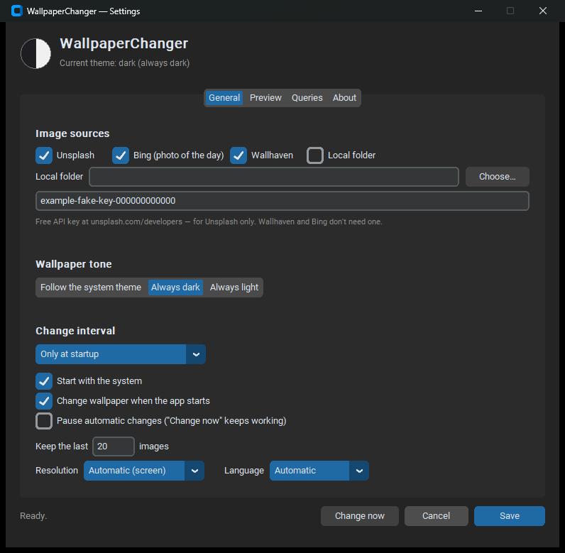
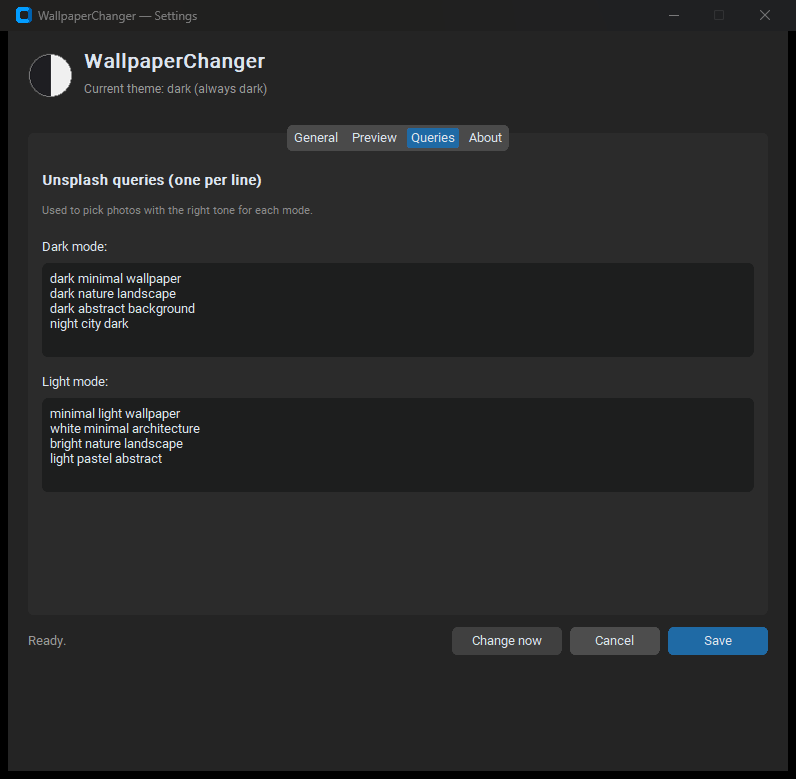
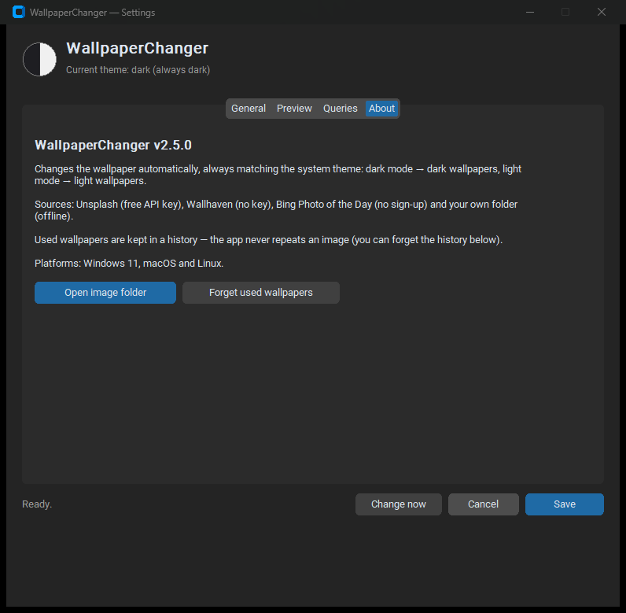

# WallpaperChanger

[](https://github.com/desorderrr/wallpaper-changer/actions/workflows/build.yml)
[](LICENSE)
[](https://www.python.org)

Changes your wallpaper automatically, **always matching the system theme**:
dark mode → dark wallpapers, light mode → light wallpapers. Available for
**Windows 11, macOS and Linux**, with a system tray icon and a modern settings
window.



## Features

- **Guaranteed dark/light tones** — the app measures the real luminance of
  every image before applying it; it never sets a light wallpaper in dark mode
  (or vice versa)
- **Follows the system theme** — on Windows it reads the "app mode"
  (`AppsUseLightTheme`) and the "Windows mode"; it also detects macOS and Linux
  (GNOME, KDE, XFCE, Cinnamon, MATE). When the theme changes, the wallpaper
  switches within seconds
- **Portuguese and English** — detects the system language automatically; you
  can choose manually in **Settings → General → Language** (tray menus and
  notifications follow the selected language too)
- **Wally-style preview** — a tab with the current wallpaper, a gallery of
  recent images (click to preview), a **New suggestion** button (fetches a new
  image without applying it) and **Apply to desktop**
- **Three image sources**
  - [Unsplash](https://unsplash.com/developers) — official API, needs a free
    *Access Key*
  - [Wallhaven](https://wallhaven.cc) — millions of 2K+ wallpapers, **no key**
  - [Bing Photo of the Day](https://www.bing.com) — no sign-up, with variety
    from the last 8 days
  - **Pick just one source or combine several** (independent checkboxes)
- **Resolution: Auto / High / Low** — Auto matches your screen (1080p, 1440p
  or 4K) so images don't waste bandwidth; High forces 4K and Low 1080p.
  Oversized downloads are downscaled before saving
- **No repeats** — persistent history of used wallpapers (exact hash +
  perceptual hash, so the same photo is caught even when recompressed); each
  source tries other candidates until it finds a new one, and the gallery
  hides duplicates too. There is a button to forget the history in the
  **About** tab
- **Offline fallback** — if the network fails (or no source has a new image of
  the right tone), the app reuses a previously saved wallpaper with the correct
  tone instead of leaving the desktop unchanged
- **Intervals**: at startup only, 5, 10, 15, 30 minutes, 1, 2, 3, 6, 12 hours
  or daily
- **Pause automatic changes** — pause without closing the app; "Change now"
  still works
- **Start with the system** (Registry on Windows, LaunchAgent on macOS, XDG
  autostart on Linux)
- **Modern interface** (customtkinter) with automatic dark/light mode
- **Single instance**, wallpaper updates protected against concurrent changes
  and automatic cleanup of old images
- Keeps the last N images in the data folder, with tone-specific queries

| Preview | Queries | About |
|---|---|---|
|  |  |  |

## Installation

### Windows 11

1. Download `WallpaperChanger.exe` from the [Releases](https://github.com/desorderrr/wallpaper-changer/releases)
   page (or from the CI artifacts)
2. Run the `.exe` — a **half-dark / half-light** icon appears in the tray
   (the `^` arrow next to the clock)
3. Right-click the icon → **Settings...**

### macOS

Requires Python 3.10+:

```bash
git clone https://github.com/desorderrr/wallpaper-changer.git
cd wallpaper-changer
pip install -e .
python -m wallpaper_changer
```

On the first wallpaper change, macOS asks for permission to control
**System Events** — allow it so the app can change the desktop background.

You can also build the app: `bash scripts/build_macos.sh` (creates
`dist/WallpaperChanger.app`).

### Linux

Requires Python 3.10+ and `tkinter`:

```bash
sudo apt install python3-tk python3-venv     # Debian/Ubuntu
git clone https://github.com/desorderrr/wallpaper-changer.git
cd wallpaper-changer
python3 -m venv .venv && . .venv/bin/activate
pip install -e .
python -m wallpaper_changer
```

System tray:

- **GNOME**: install the [AppIndicator](https://extensions.gnome.org/extension/615/appindicator-support/)
  extension and `gir1.2-ayatanaappindicator3-0.1`
- **KDE / XFCE / Cinnamon / MATE**: works with the X11 backend
  (`python-xlib` is installed automatically)
- On pure Wayland without XWayland the tray may not appear — wallpaper
  changes still work

Wallpaper support by environment: GNOME/Unity/Pop, Cinnamon, MATE, KDE Plasma
(`qdbus`) and XFCE (`xfconf-query`), with an `feh` fallback on X11.

Binary: `bash scripts/build_linux.sh` (creates `dist/wallpaper-changer`).

### From source (any system)

```bash
pip install -e .
python -m wallpaper_changer              # starts in the tray
python -m wallpaper_changer --settings   # opens settings immediately
```

## Setting up Unsplash (1 minute)

1. Create an account at <https://unsplash.com/developers>
2. **New Application** → accept the terms
3. Copy the **Access Key**
4. In the app: **Settings → Image sources** → paste the key → **Save**

Without a key, the app uses only Wallhaven and Bing (neither needs sign-up).
Your settings live in:

| System | Folder |
|---|---|
| Windows | `%APPDATA%\WallpaperChanger` |
| macOS | `~/Library/Application Support/WallpaperChanger` |
| Linux | `~/.config/wallpaper-changer` |

## Development

```bash
pip install -e ".[dev]"
pytest -q
```

Structure:

```
src/wallpaper_changer/
├── app.py          # tray, scheduler, change logic, single instance
├── ui.py           # settings window (customtkinter)
├── i18n.py         # pt/en translations (in-code catalog, no .mo files)
├── resolution.py   # screen detection and per-source target size
├── config.py       # settings, paths, migrations
├── history.py      # used-wallpaper history (no repeats)
├── sources.py      # Unsplash + Wallhaven + Bing
├── tone.py         # luminance / tone matching
├── assets.py       # code-generated icon
└── platform/
    ├── win.py      # registry, SystemParametersInfoW
    ├── macos.py    # AppleScript, LaunchAgent
    └── linux.py    # gsettings/qdbus/xfconf, XDG autostart
```

CI: `.github/workflows/build.yml` lints and tests on Windows and Linux
(Python 3.10 and 3.12). Pushing a `v*` tag builds all three platforms and
publishes a Release with the binaries.

```bash
git tag v2.4.0 && git push origin v2.4.0
```

## Platform status

| Platform | Automated tests | Real-world run |
|---|---|---|
| Windows 11 | ✅ 64 tests | ✅ tested |
| Linux (Ubuntu 26.04, WSL) | ✅ 64 tests (UI skipped without tkinter) | 🟡 tray not yet tested on a real desktop |
| macOS | ✅ CI builds the app on releases | 🧪 not yet tested on a MacBook |

## License

[MIT](LICENSE) © Des

Release history in the [CHANGELOG](CHANGELOG.md).
